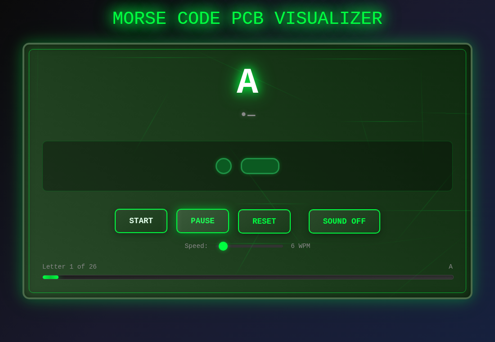

# Morse Code PCB Visualizer

A little page for learning the Morse alphabet, dressed up as a glowing circuit board. It goes through the letters A to Z, keying each one out in light and sound, and only shows you the letter once its code has finished, so you can try to read it first.

Try it at https://dimitry4now.github.io/morse-visualization/

## How it works

Press Start, or Space, and it begins with A. Each dot and dash lights up while its tone plays and then stays faintly lit, so you see the letter's pattern build up as you hear it. The Sound button turns the audio on. Dots and dashes are the same 650 Hz tone and differ only in length, like on a real key.

The speed slider goes from 5 to 25 words per minute and takes effect straight away. R starts over from A.

The timing follows the usual Morse rules: a dash is three dots long, and the gap between the parts of a letter is one dot. One of these units lasts 1200 / WPM milliseconds, so 120 ms at 10 WPM. Between letters it waits longer than the standard three units, which is how Morse is usually taught: the letters come at full speed, with more time to think in between.

If you're just starting, go slow (5 to 8 WPM) with the sound on, try to name each letter before it appears, and pause on the ones that keep catching you out.

## Running it locally

It's one static page with no dependencies. Open `index.html` in a browser, or serve the folder with `python3 -m http.server`.

## Ideas for later

Numbers and punctuation, typing your own text to send, and a quiz mode that keeps score.

## License

MIT, see [LICENSE](LICENSE). For bugs or questions, open an issue or write to dimitarbetinski@gmail.com.
